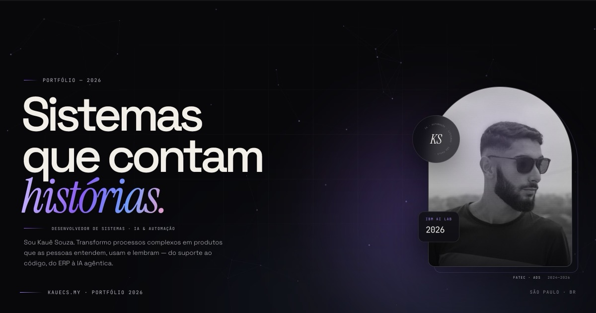
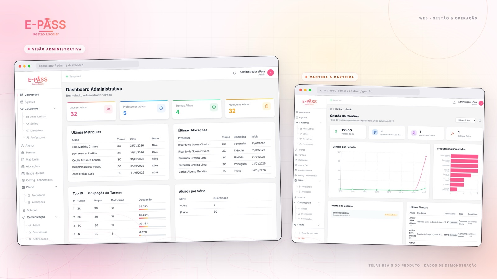

<div align="center">

# Toda linha começa com uma pergunta.

**E se um portfólio pudesse ser lido como uma história?**

<p>
  <a href="https://kauecs.my"></a>
  <a href="curriculo_kaue.pdf"></a>
  <a href="https://www.linkedin.com/in/kau%C3%AA-costa-souza-5a510523b"></a>
  <a href="mailto:kauekaue960@gmail.com"></a>
</p>

<p><sub>São Paulo, Brasil · Desenvolvedor de Sistemas · IA &amp; Automação</sub></p>

<a href="https://kauecs.my">
  
</a>

</div>

---

> A maioria dos portfólios responde **“o que você sabe?”**.
>
> Este tenta responder outra coisa: **“o que você faz com o que sabe?”**

Meu nome é **Kauê Costa Souza**. Trabalho com tecnologia desde 2024, construindo sistemas, automatizando rotinas e integrando o tipo de processo que costuma viver em planilhas, silos e finais de tarde corridos. Hoje sou responsável pelo departamento de TI de uma consultoria em São Paulo e curso Análise e Desenvolvimento de Sistemas na Fatec.

Este repositório é o backstage desse site — e também uma tentativa de contar trajetória sem transformar tudo em uma lista de logos.

---

## 📖 O site em quatro capítulos

A landing page foi desenhada para ser percorrida como uma narrativa, não como um currículo com scroll.

| Cap. | Nome | O que acontece |
|:---:|---|---|
| **00** | **Prólogo** | Um retrato, uma promessa e a pergunta que abre tudo. |
| **01** | **A faísca** | A curiosidade antes do código — e a frase que atravessa a história. |
| **02** | **A construção** | Uma cena fixa acompanha a passagem de suporte → automação → integração → IA agêntica. |
| **03** | **Os sistemas** | Prisma.AI e ePass, apresentados como produtos, não como repositórios. |
| **04** | **O arsenal** | O que uso para construir — e o que sustenta a entrega. |

O contato fica fora da numeração.

> **A pergunta que guia o site:** *como fazer melhor?*

---

## ✦ Os dois sistemas em destaque

<table>
<tr>
<td width="50%" valign="top">

### 01 · [Prisma.AI](https://github.com/kaue-souza7/prisma-ai)

**Aprender finanças é praticar o próximo passo.**

Plataforma gamificada de educação financeira para jovens adultos: **12 trilhas**, **45 missões** e agentes de IA que acompanham o raciocínio. Sem pedir acesso a dados bancários.

`React` · `TypeScript` · `FastAPI` · `PostgreSQL` · `SQLAlchemy` · `Docker`

[](https://github.com/kaue-souza7/prisma-ai)

</td>
<td width="50%" valign="top">

### 02 · [ePass](https://github.com/kaue-souza7/epassProject)

**A escola inteira, em um só lugar.**

Gestão escolar de ponta a ponta — do diário de classe ao lanche na cantina. Web para a gestão, mobile para famílias e professores, e **Atena**, uma IA que roda dentro da escola.

`Python` · `FastAPI` · `PostgreSQL` · `React` · `Expo` · `Ollama`

[](https://github.com/kaue-souza7/epassProject)

</td>
</tr>
</table>

<sub>As imagens são telas reais dos projetos, com dados de demonstração.</sub>

### Outros projetos

- **[API SOAP · Prefeitura](https://github.com/kaue-souza7/api-webservice-prefeitura)** — automação da emissão de notas fiscais via API SOAP.
- **[Trabalho remoto vs. escritório](https://github.com/kaue-souza7/proj-data-analysis)** — produtividade e bem-estar em diferentes modelos de trabalho.
- **[Data Science · Michigan](https://github.com/kaue-souza7/datascience-um)** — trilha prática de ciência de dados pela Universidade de Michigan.

---

## 🎬 O design não é enfeite

O objetivo era fazer o site se comportar como um filme: cada scroll revela uma ideia, não apenas mais um bloco.

- **Abertura com contagem e cortina.** O preloader apresenta o capítulo antes de deixar a cena aparecer.
- **Hero com constelação em canvas.** Partículas se conectam e reagem ao mouse — uma metáfora discreta para dados que viram sistemas.
- **Tipografia que entra em cena.** Linhas são reveladas com máscaras; a palavra em itálico carrega a emoção de cada capítulo.
- **Citação palavra por palavra.** A pergunta do início acende conforme você desce — dá para ler a história no ritmo do scroll.
- **Jornada em cena fixa.** Quatro fases da trajetória trocam no mesmo palco, com interfaces construídas em HTML/CSS: operação, terminal, mapa de integração e orquestração de agentes.
- **Projetos com câmera lenta.** Só um parallax sutil, cursor customizado e imagens em perspectiva — o produto é o protagonista.
- **PT/EN de verdade.** Todo o conteúdo narrativo tem versão em inglês, não apenas o menu.
- **Movimento com respeito.** Com `prefers-reduced-motion`, a jornada vira leitura estática, o canvas desaparece e nenhuma história fica escondida.

### Stack do site

<p>
  
  
  
  
  
</p>

Sem framework, sem build. **HTML, CSS e JavaScript** — com GSAP, ScrollTrigger e Lenis vendorizados no próprio repositório. As fontes também são servidas localmente.

---

## 🚀 Rodando localmente

```bash
git clone https://github.com/kaue-souza7/portfolio.git
cd portfolio

# qualquer servidor estático funciona
python3 -m http.server 8000
```

Depois abra **http://localhost:8000**.

> Não é necessário `npm install`. O site é 100% estático.

### Estrutura

```text
portfolio/
├── index.html            # a história inteira
├── css/
│   ├── style.css         # direção visual, cenas e responsividade
│   └── fonts/            # fontes servidas localmente
├── js/
│   ├── script.js         # narrativa, i18n, cursor, canvas e motion
│   └── vendor/           # GSAP, ScrollTrigger e Lenis
├── img/
│   ├── foto.jpg
│   └── work/             # telas de Prisma.AI e ePass
├── curriculo_kaue.pdf
└── README.md
```

---

## 💼 Experiência em uma linha

**Assistente de TI & Implantação** na **Podemos Consultoria Empresarial** (dez/2024 — hoje), responsável pelo departamento de TI, automações em Python/FastAPI, integrações ERP/PDV e dados para decisões. Em 2026, participei do **IBM AI Experiential Learning Lab for Brazil**, construindo uma solução de **IA agêntica** com IBM Cloud, watsonx Orchestrate, watsonx e IBM Bob.

- **Formação:** Fatec · Análise e Desenvolvimento de Sistemas (2024—2026)
- **Idiomas:** Português · Inglês intermediário · Espanhol básico
- **Base:** São Paulo · CNH e CDI

---

## 🧭 Contato

Se você chegou até aqui e tem um problema interessante, um time que gosta de resolver ou uma pergunta que ainda não tem resposta:

<div align="center">

### Vamos conversar?

<a href="mailto:kauekaue960@gmail.com"><strong>kauekaue960@gmail.com</strong></a> · <a href="https://www.linkedin.com/in/kau%C3%AA-costa-souza-5a510523b">LinkedIn</a> · <a href="https://github.com/kaue-souza7">GitHub</a>

<sub>Feito à mão, sem template. Código, café e curiosidade.</sub>

</div>
